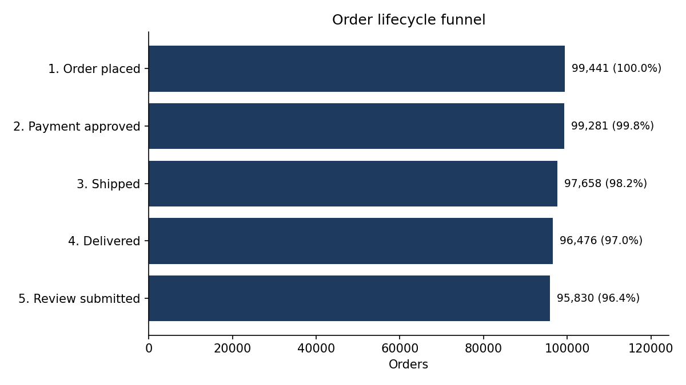
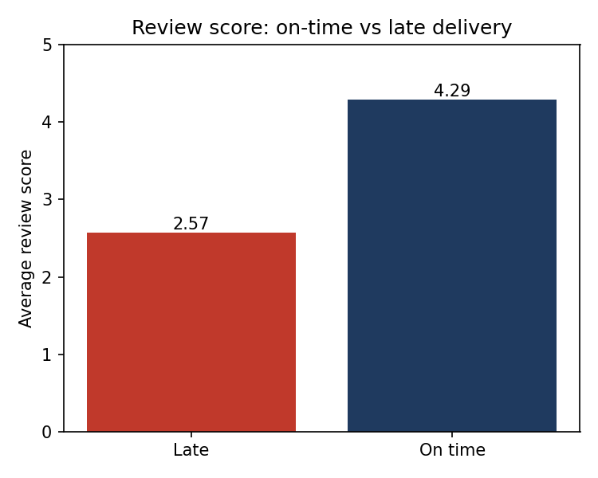
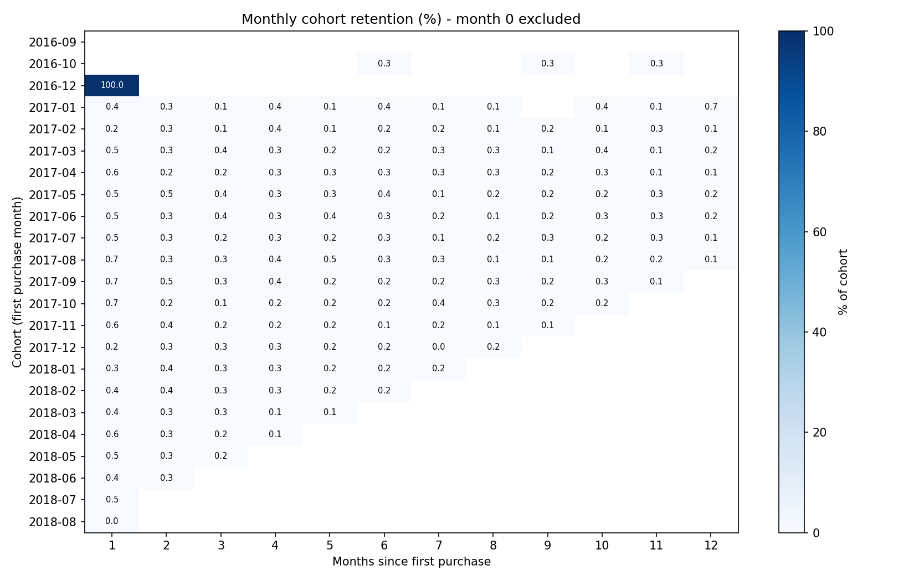
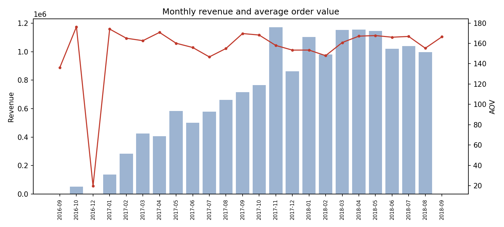

# E-commerce Funnel and Cohort Analysis (Olist)

I analysed ~100K orders from a Brazilian online marketplace (Olist) using SQL and Python. I wanted to answer a few simple questions: where do orders get stuck, do customers come back, and does late delivery really hurt reviews?

**Dataset:** [Brazilian E-Commerce Public Dataset by Olist](https://www.kaggle.com/datasets/olistbr/brazilian-ecommerce) on Kaggle (orders from 2016 to 2018).
**Tools:** SQLite, SQL (CTEs, window functions), Python (pandas, matplotlib).

## Questions I tried to answer
1. At which stage of an order do we lose the most orders?
2. Is the funnel getting better over time?
3. Does late delivery lead to worse reviews?
4. How many customers buy again?
5. How do orders, revenue and average order value (AOV) change month to month?

## What I found

**1. Funnel: very few orders are lost, and shipping is the weakest step.**
Out of 99,441 orders placed, 96,476 (97.0%) were delivered and 95,830 (96.4%) ended up with a review. The biggest drop was at the *shipped* step: only 98.4% of paid orders were shipped, which is 1,623 orders lost. Payment approval loses almost nothing (99.8% pass).



**2. The funnel got better over time.**
In early 2017 about 94% of orders were shipped. By mid-2018 it was around 99%. The share of orders with a review also went up, from about 92% to about 97-98%. (I ignored the first and last months of the data because they have only a handful of orders.)

**3. Late delivery is strongly linked to bad reviews.**
About 8% of delivered orders (7,662) arrived after the promised date. Their average review was **2.57 stars**, compared to **4.29 stars** for on-time orders. 54% of late orders got a 1-2 star review, versus 9% for on-time orders. This shows a strong link, but I can't say late delivery is the only reason for low scores.



**4. Most customers buy only once.**
Only 2,888 of 94,990 customers (3.04%) ordered more than once. On average, month-1 retention across cohorts is just 0.45%. When people do come back, the second order comes about 81 days after the first one. Because retention is so low, the cohort heatmap is sparse and I treat it as a rough guide only.



**5. Revenue grew a lot, but AOV stayed flat.**
Monthly orders went from under 1,000 in January 2017 to around 6,000-7,000 per month in 2018. Total revenue is about 15.7 million (the payment values in the dataset). November 2017 was the best month (about 1.17M revenue, 7,423 orders), probably because of Black Friday, though I did not check this in the data. AOV stayed in a narrow range of roughly 147 to 176 the whole time, so growth came from more orders, not bigger baskets.



## Ideas based on the numbers
- **Focus on delivery time.** Late orders are only 8% of orders but they get much worse reviews. Better delivery estimates or fixing slow sellers/regions looks like the most useful thing to try first.
- **Look at repeat purchase.** With only 3% of customers coming back, even a small improvement (for example, a follow-up offer around day 60-80, when repeat orders usually happen) could matter.
- **Check the shipping step.** It is the largest drop in the funnel, so it is worth finding out which orders get stuck there.

## How I built it
- `src/load_data.py` loads 5 Olist CSV files into SQLite.
- `sql/00_views.sql` creates helper views. Revenue and review score are summed per order *before* joining, so rows are not duplicated by the join.
- `sql/01` to `sql/07` contain the analysis: funnel, funnel by month, delivery vs review, cohort retention, repeat behaviour, repeat rate and monthly KPIs.
- `src/run_analysis.py` runs everything, saves tables to `outputs/tables/`, charts to `outputs/charts/`, and writes `outputs/insights.md`.
- `powerbi/POWERBI_GUIDE.md` explains how to build a dashboard from the output CSVs.

## Project structure
```
sql/        SQL queries (00_views ... 07_monthly_kpis)
src/        load_data.py, run_analysis.py, make_sample_data.py
data/raw/   put the real Olist CSVs here (not uploaded to GitHub)
data/sample synthetic data, only to test that the code runs
outputs/    tables (CSV), charts (PNG), insights.md
powerbi/    dashboard guide and DAX measures
```

## How to run
```bash
pip install -r requirements.txt

# 1. Download the Olist dataset from Kaggle and put these files in data/raw/:
#    olist_orders_dataset.csv, olist_customers_dataset.csv, olist_order_payments_dataset.csv,
#    olist_order_items_dataset.csv, olist_order_reviews_dataset.csv

# 2. Run
python src/run_analysis.py
```
To only test that the code works, you can use fake data: `python src/make_sample_data.py && python src/run_analysis.py --sample`. Do not quote numbers from that.

## Limitations
- There is no website click data (visits, add to cart), so this is an **order lifecycle** funnel, not a browsing funnel.
- `customer_id` changes with every order, so I used `customer_unique_id` to identify the same customer.
- Cohort = month of the customer's first order. Canceled and unavailable orders are left out of retention and KPIs.
- A review counts only if the order was delivered.
- The first and last months of the dataset have very few orders, so their percentages (like month-over-month growth) are not reliable.
- The late-delivery result shows a link, not proof of cause.